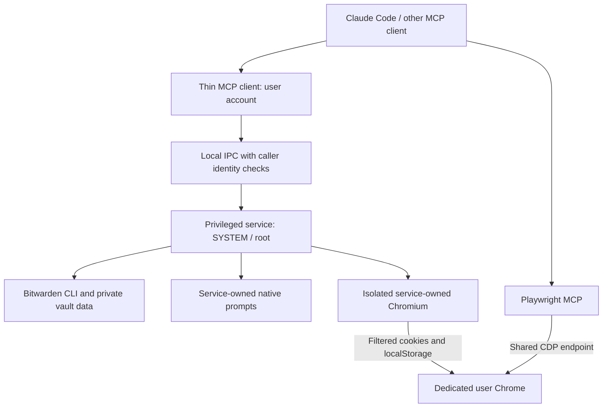

# U-Chan Secrets V5

A local MCP server that signs into approved websites with Bitwarden credentials. A privileged service performs credential entry in an isolated browser and transfers filtered session state into a dedicated Chrome or Edge profile.

Version `5.0.0` adds selectable Chrome/Edge desktop destinations and checks approved login evidence before and after session transfer. Chrome remains the default when no browser has been selected. Protocol and protected-state schema remain version 3. Source integration, publication, and installed verification are separate events.

**Verification:** Windows/macOS build and test CI is separate from installed-service security verification. Native process identity, input isolation, permissions, and installation rehearsals remain [release gates](docs/attack-checklist.md). See [validation evidence](docs/superpowers/research/2026-10-29-v3-validation.md) and [SECURITY.md](SECURITY.md).

The [Windows V4 rollout](docs/superpowers/research/2026-10-29-v4-rollout.md) records matching service/CLI versions, preserved protected state, real setup and fresh MCP/browser checks. It builds on the tightened V3.0.3 [native closeout](docs/superpowers/research/2026-10-29-v3-windows-closeout.md). macOS runtime remains unverified; source merge, installed verification, and package publication are recorded separately.

## What V3 changes

- **Diagnose:** `u-chan doctor` explains service, vault, permission, Chrome, and browser-sharing problems without fetching credentials or repairing configuration.
- **Limit approval:** approve one login attempt, a fixed duration, or permanent future logins.
- **Confirm outcomes:** an approved URL or selector provides authentication evidence; generic form completion remains explicitly unconfirmed.
- **Manage access:** `u-chan manage` shows grant pages and recent sanitized activity, with lock, unlock, and revoke actions.
- **Preserve state:** privileged migration backup, schema/downgrade guards, and state-preserving reinstall replace manual editing of protected files.

Windows Hello and Touch ID remain [research only](docs/superpowers/research/2026-10-29-native-approval.md). Linux, general SSO/OAuth, passkeys, and automated CAPTCHA solving are outside V3.

## What V5 adds

Choose your browser from a normal Windows terminal:

```powershell
u-chan setup --browser edge --json
u-chan setup --browser edge --apply --replace-existing --start-browser
u-chan setup --browser chrome --apply --replace-existing --start-browser
```

The first command inspects the proposed choice. `--apply` saves it in user-side `browser.json` and registers the matching MCP environment through the official Codex CLI. Later commands without `--browser` keep the saved choice; a new installation defaults to Chrome. Browser and Codex configuration backups are retained under their respective `#0 backup` directories. Each user's choice is independent.

Chrome and Edge use separate dedicated profiles. Only one browser owns the configured U-Chan CDP endpoint at a time. When switching, close the previous **dedicated U-Chan instance** and rerun setup; keep your personal browser windows open. U-Chan refuses wrong, unknown, personal-profile, or non-loopback listeners instead of silently attaching, selecting another port/browser, or terminating processes. It does not install browsers or change enterprise debugging policy. The legacy `scripts/start-chrome.ps1` explicitly selects Chrome; `scripts/start-browser.ps1 -Browser edge` selects Edge.

The service independently checks the installed owner's SID and dedicated profile before accessing the Windows destination. It derives that user's AppData paths from the profile registry. Advanced installations with a custom desktop profile root must align the trusted service environment's `U_CHAN_DESKTOP_HOME` with the user-side home; changing only a user-side environment variable does not redirect privileged session transfer.

An approved exact URL or visible selector must match in both the private login context and a new verification tab in the destination browser before `login` returns success. Existing user tabs are left alone. Missing evidence returns `authentication_unconfirmed`; private success with unverified desktop state returns `destination_unconfirmed`. Transfer failure/cancellation can leave partial session state and does not log the browser out. Expired or consumed grants are not refunded.

The private credential-bearing context uses a per-attempt HTTP/CONNECT proxy to block network destinations outside approved hosts, including redirect chains and worker/frame requests. Service workers are disabled. Private Chromium disables HTTP/2 and QUIC so connections cannot coalesce across approved and unapproved origins; HTTP/2-only sites may be unsupported. TLS remains end-to-end with normal browser certificate validation. Some sites requiring third-party resources or external identity providers also remain unsupported; U-Chan does not silently broaden host approval. CAPTCHA, passkey, push approval, or unavailable/rejected TOTP returns `needs_human` with manual sign-in guidance. V5 does not expose or resume the private challenge context, repeat credential submissions, or ask for passwords/codes in AI chat.

A V5 client requires the service's `verified_session_transfer` capability before login and binds the request to its selected browser. Update both CLI and service; an older service is refused before a login attempt is sent. An old client without a browser field retains its legacy Chrome destination. A stale MCP browser environment that conflicts with the saved choice is refused until the AI session restarts. Existing grants and vault data remain compatible. Native macOS runtime and ownership by an already-running AI session remain unverified.

Other MCP clients may set `U_CHAN_BROWSER=edge` (or `chrome`) and the matching loopback `U_CHAN_CDP` in their own registration, then launch the matching dedicated browser. Automatic registration remains Windows/Codex only; setting a desktop environment variable does not change the privileged service's endpoint.

## What V4 adds

Use a normal, non-administrator terminal after installing the matching trusted service:

```powershell
u-chan setup --json
u-chan setup --client codex --apply
u-chan setup --client codex --apply --replace-existing --start-browser
```

The first command only inspects. `--apply` adds missing Codex MCP registrations through the official Codex CLI. `--replace-existing` also permits replacement of recognized simple registrations. Existing configuration is backed up under the Codex configuration directory's `#0 backup` before mutation. Compatible enabled registrations retain custom environment, working directory, tool filters, timeouts, and other settings. Incompatible custom registrations, conflicting target overrides, disabled entries, and HTTP transports require manual configuration and remain untouched. Partial failures retain completed changes and the backup; setup never restores an obsolete whole configuration over concurrent edits.

`--start-browser` explicitly starts the selected dedicated browser profile in the background when its endpoint is unhealthy. No startup task is added. Setup refuses elevated execution and known service/desktop browser-target mismatches. It never installs the privileged service or changes UAC. Run `u-chan install` separately from a trusted administrator terminal.

Setup reports `configured` or `needs_attention`, plus `sharing` and `restartRequired`. `process_configured` means matching process arguments were observed; it does not verify active AI-session ownership. Unobservable sharing remains `unobserved`. Restart the AI session after registration changes. Exit codes: 1 means attention required, 2 means configured with restart required, and 0 means configured without a known restart requirement. A locked vault remains a valid installed state.

Automatic registration supports Codex on Windows only. Configure other clients manually using their documented MCP commands. macOS runtime remains unverified. `doctor` compares the actual CLI and installed service versions, both browser targets, and Windows UAC policy; missing metadata remains unknown. `manage` shows the installed service version and browser status.

Propose a site grant with an explicit success condition:

```sh
u-chan allow example.com --login-url https://example.com/login --item "Example account" --once --success-url https://example.com/dashboard
u-chan allow example.com --login-url https://example.com/login --item "Example account" --minutes 30 --success-selector "button[data-action='sign-out']"
```

The service still requires protected approval. The CLI defaults to one login attempt; timed approvals accept 1–1440 whole minutes, and `--permanent` requests permanent future logins. URL and selector success conditions are mutually exclusive. Without one, login may return `authentication_unconfirmed`; independently verify the signed-in page. Grant expiry does not log out an already transferred browser session.

## Architecture



The service owns the allowlist, settings, audit log, runtime, dependencies, Bitwarden executable, and isolated Chromium bundle. The thin client holds no vault credentials. Windows prompts require SYSTEM identity and a separate input desktop; replies cross sessions through a SYSTEM-only named pipe. macOS uses secure password entry and permits hardcore mode only.

A Bitwarden session is held in service memory and passed to privileged Bitwarden subprocesses when needed. It is not stored in desktop configuration or a session file. Vault access expires after the configured idle interval (12 hours by default), manual lock, restart, or reboot. This does not claim cryptographic zeroization of JavaScript strings or OS memory.

**After session transfer, the AI can use the signed-in website.** Grant expiry and revocation stop future U-Chan logins; they do not invalidate existing Chrome sessions or prevent actions inside those sessions. Revocation waits for an earlier queued login to finish.

## Prerequisites

- Windows or macOS.
- Node.js 24+.
- A native Bitwarden CLI executable: `bw.exe` on Windows or `bw` on macOS. The Windows npm `.cmd` shim is unsupported.
- Google Chrome for the user-side dedicated profile.
- The matching Playwright Chromium installation for service staging.

Install from a trusted shell before granting an AI unrestricted user-account access. On Windows, use UAC **Always notify** or run the AI from a standard user account. Existing administrator/root compromise is outside the threat model.

## Build and install from source

Use a reviewed checkout for the desired source version. Unversioned npm installation can select a different published version; the package metadata in this repository is not proof of npm publication.

```sh
git clone https://github.com/anchuwithdeadline/u-chan-secrets.git
cd u-chan-secrets
npm ci
npm run build
npx playwright install chromium
```

The following setup commands use `node dist/cli.js` from that checkout. After a matching package is globally installed, `u-chan` invokes the same CLI. The globally installed MCP command is `u-chan-secrets`.

### Windows

From a trusted elevated PowerShell terminal in the checkout:

```powershell
node dist/cli.js install --mode hardcore
```

Windows also supports `--mode easy`; omitting the mode uses the Windows installer default, easy. The installer generates a phrase unless one is supplied. Reinstall preserves existing owner/settings and grants rather than applying new mode/phrase arguments over them.

For the one-time login to the service's private Bitwarden store, use the copied native executable in that same elevated terminal:

```powershell
$env:BITWARDENCLI_APPDATA_DIR = Join-Path $env:ProgramData 'u-chan-secrets\bw-data'
Remove-Item Env:\BW_SESSION -ErrorAction SilentlyContinue
& (Join-Path $env:ProgramData 'u-chan-secrets\bin\bw.exe') login
Remove-Item Env:\BITWARDENCLI_APPDATA_DIR
```

**Do not use `scripts/debug-install.bat` as a V3 setup or upgrade path.** That legacy script invokes uninstall, which deletes service data, and exports protected settings into the checkout. Use the CLI installer above.

### macOS

From the trusted checkout:

```bash
sudo "$(command -v node)" dist/cli.js install
sudo env -u BW_SESSION \
  BITWARDENCLI_APPDATA_DIR="/Library/Application Support/u-chan-secrets/bw-data" \
  "/Library/Application Support/u-chan-secrets/bin/bw" login
```

The daemon uses `/Library/Application Support/u-chan-secrets` and `/Library/LaunchDaemons/com.uchan.secrets.plist`. macOS always uses hardcore approval; easy mode is refused.

### Register MCP and shared Chrome

For a source checkout, register the absolute path to the thin client:

```sh
claude mcp add u-chan-secrets -- node "/absolute/path/to/u-chan-secrets/dist/index.js"
claude mcp add playwright -- npx @playwright/mcp@latest --cdp-endpoint http://127.0.0.1:9222
```

If a Playwright MCP registration already exists, replace it with the shared-CDP configuration and restart the AI session. A globally installed matching package can instead register `claude mcp add u-chan-secrets -- u-chan-secrets`.

Start the dedicated Chrome profile from the checkout:

| Platform | Command |
|---|---|
| Windows | `powershell -File scripts\start-chrome.ps1` |
| macOS | `bash scripts/start-chrome.sh` |

Use a normal user terminal for daily operations:

```sh
node dist/cli.js doctor
node dist/cli.js unlock
```

Check the phrase in the genuine protected prompt before entering a password. Never send passwords, TOTP seeds/codes, or vault session keys to an AI conversation.

## Daily commands

The table uses the globally installed `u-chan` spelling; from source use `node dist/cli.js` with the same arguments.

In Windows PowerShell, use `u-chan.cmd` if execution policy blocks npm's `.ps1` shim, for example `u-chan.cmd doctor --json`. No machine execution-policy change is needed.

| Command | Purpose |
|---|---|
| `doctor [--json]` | Read-only diagnostic report and safe next actions |
| `setup [--client codex] [--apply] [--replace-existing] [--start-browser] [--json]` | Windows desktop inspection and explicit Codex/browser setup |
| `allow <domain> --login-url <https-url> --item <label> [--once\|--minutes N\|--permanent] [--success-url URL\|--success-selector SELECTOR]` | Propose a scoped grant through protected approval |
| `manage` | Native status, grant pages, recent activity, lock/unlock, and revocation |
| `unlock` | Request the protected master-password prompt |
| `lock` | Forget the service's vault session and request vault lock |
| `mode <easy\|hardcore>` | Change approval mode; lowering protection requires a protected password check |
| `audit [limit]` | Read recent service audit records |
| `import-v1 [path]` | Approve each imported entry in a protected window; imported grants are permanent |
| `update` | Request a verified compatible package update; some changes require administrator reinstall |
| `install [--mode <easy\|hardcore>] [--phrase <phrase>]` | Privileged install/reinstall; existing settings are preserved |
| `uninstall` | Privileged removal of the service **and all its data** |

Doctor reports `pass`, `fail`, or `unknown`. Exit 0 means required checks passed; 1 means a required check failed; 2 means required checks remain unknown without a failure. A locked vault is a valid state with an unlock instruction. Unobservable Playwright sharing is advisory; a known mismatch fails doctor. Diagnosis never retrieves credentials, opens an unlock prompt, or changes configuration.

Manage shows 20 grants per page. It cannot create or extend a grant. Unlock closes the management dialog before opening the protected password prompt.

## MCP tools and approvals

The five AI-facing tools remain:

| Tool | Behavior |
|---|---|
| `status` | Vault state, approval mode, and observable Playwright sharing |
| `request_allow(domain, login_url, item, selectors?, grant?, success?)` | Request protected approval of the complete entry and duration |
| `login(domain)` | Check/reserve the grant, sign in privately, and transfer permitted session state |
| `list_allowed` | Show authorized item/hosts and permanent, timed, expired, or exhausted grant state |
| `revoke(domain)` | Remove a grant without another approval; waits behind an earlier login |

Use the Bitwarden item ID or name supplied by the user; do not guess a vault item. Optional selectors cover username, password, submit, and OTP fields.

Example `request_allow` arguments:

```json
{
  "domain": "example.com",
  "login_url": "https://example.com/login",
  "item": "the Bitwarden item ID supplied by the user",
  "grant": { "kind": "timed", "minutes": 30 },
  "success": { "url": "https://example.com/dashboard" }
}
```

| Grant | Meaning |
|---|---|
| `{ "kind": "once" }` | One attempt after vault/Chrome preflight; failure after reservation still consumes it |
| `{ "kind": "timed", "minutes": 30 }` | Future logins until the exact approved UTC expiry; integer range 1–1,440 minutes |
| `{ "kind": "permanent" }` | Permanent future logins |
| Omitted | Permanent, preserving existing callers; the protected prompt states this |

The AI proposes policy; the human authorizes it through the protected prompt. V3 clients refuse new options against a service that lacks the corresponding capability.

Changing identity, hosts, selectors, duration, or success conditions requires a new approval. A timed request that expires while its window is open is refused. Detected backward-clock changes invalidate affected persisted timed grants; renewed approval is required. Clock changes while the service is stopped cannot be reconstructed.

Easy mode exists only on Windows. Hardcore approvals require the master password. Protected prompts time out after two minutes. Five incorrect password attempts lock password-checked operations for 15 minutes.

### Login results and 2FA

A success condition is one exact approved HTTPS URL or a visible-element selector, such as `{ "selector": "#signed-in-account" }`. Choose evidence specific to the authenticated page: `body` or another generic element is not meaningful proof. The service checks the allowed host around evidence evaluation and transfer.

Without approved evidence, a generic completed flow may transfer filtered state but returns `ok: false` with `authentication_unconfirmed`. Inspect Chrome before continuing. An unmet configured condition prevents transfer. Other fixed result codes distinguish grant expiry/exhaustion, vault/Chrome availability, human verification, timeout, and transfer failure.

The service supports Bitwarden TOTP for recognized one-time-code fields. Passwords, TOTP seeds, and generated codes stay inside the privileged login flow. CAPTCHA, device verification, and unsupported challenges require the user; the AI must not request the underlying credentials.

## Upgrade, backup, and rollback

Use a trusted administrator reinstall for the first V3 installation; the thin client alone does not upgrade native helpers or private executables. Windows reinstall stops the service, waits for shutdown, stages a fresh private program copy, preserves the old program under protected `#0 backup`, and reuses service registration. Existing settings and grants remain.

Before the first grant-state mutation, the service creates a protected `#0 backup/v2-before-v3` snapshot and a `schema.json` marker. The snapshot may contain privileged configuration and encrypted vault data: never copy it into a user-readable checkout. Incomplete backups block mutation rather than being overwritten.

Supported V3 tooling refuses V2 downgrade after migration. Historical V2 administrator tools cannot enforce a newer schema guard. A deliberate rollback requires stopping the service, inspecting/restoring the protected pre-V3 state, and acknowledging that old permanent approvals return. Do not uninstall as an upgrade shortcut: uninstall deletes the data.

Package updates verify registry signatures and integrity and retain private dependencies. Changed dependencies or native helpers require a trusted administrator reinstall. Expired/exhausted grants and already transferred website sessions are separate from vault lock and upgrade state.

Versions 3.0.0–3.0.2 have an npm signature-verification defect and cannot reliably bootstrap their own update. Install the matching corrected package from a trusted shell, then use the administrator reinstall above. Version 3.0.3 requires SHA-512 integrity and a valid signature from its pinned npm key; unsigned repository-attestation JSON cannot replace that signature. Future signing-key rotation fails closed and requires a trusted verifier upgrade.

For V1 data, use `u-chan import-v1 [path]`: each entry requires protected approval. Retire user-side Bitwarden sessions and the old `bw-session` file through a trusted migration process; never copy them into the service as trusted authorization.

## Validation and security

```sh
npm test
npm run build
```

[CI](https://github.com/anchuwithdeadline/u-chan-secrets/actions/workflows/ci.yml) runs builds/tests on Windows and macOS. CodeQL checks source separately. Passing these checks does not prove actual SYSTEM/root prompt isolation or certify an installed service.

Before release or reliance on the security boundary, perform the [manual attack checklist](docs/attack-checklist.md). See [validation and remaining native checks](docs/superpowers/research/2026-10-29-v3-validation.md), [security policy](SECURITY.md), and [V3 change notes](CHANGELOG.md).

## License

[MIT](LICENSE)
