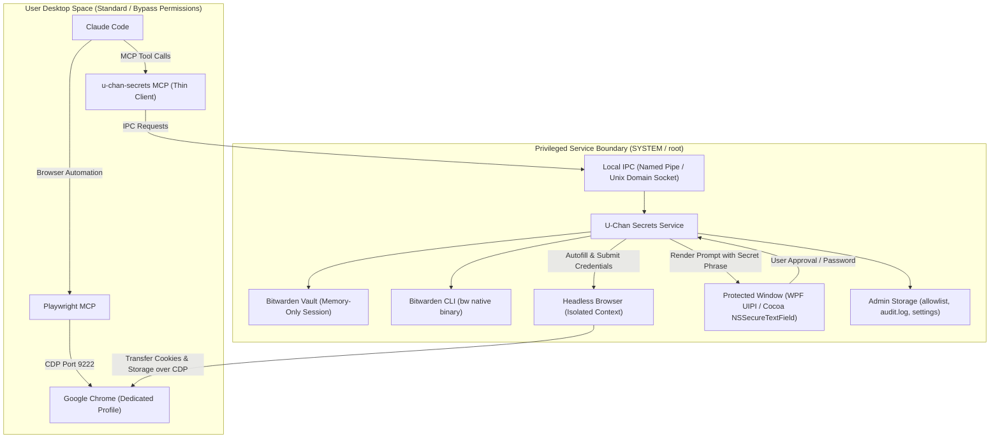

# U-Chan Secrets V2

A hardened Model Context Protocol (MCP) server that enables Claude Code to authenticate into allowlisted websites using Bitwarden credentials—without exposing passwords, TOTP seeds, or vault session keys to the AI model or the user-level desktop environment.

Even if Claude Code is tricked by prompt injection or operated in bypass permissions mode (`--dangerously-skip-permissions`), credentials remain protected behind an OS-level privileged service boundary.

---

## Architecture Overview

U-Chan Secrets V2 splits operations across an OS privilege boundary:



### Key Security Components

- **Privileged Background Service:** Runs under `SYSTEM` on Windows or `root` via `launchd` on macOS. Owns all sensitive configuration files (`allowlist.json`, `settings.json`, `audit.log`, and Bitwarden CLI vault data). Inaccessible to normal user accounts.
- **Memory-Only Session:** Master password unlocks the vault into service process memory only (`BW_SESSION`). The session is never written to disk and automatically expires on reboot, service restart, manual lock, or after a 12-hour idle timeout.
- **Thin MCP Client:** Claude Code communicates exclusively with a thin client over local authenticated IPC (`\\.\pipe\u-chan-secrets` on Windows with caller SID validation; `/var/run/u-chan-secrets/ipc.sock` on macOS with peer UID verification).
- **Protected Windows:** Unlock dialogs, approval prompts, and mode changes execute directly within privileged service UI:
  - **Windows:** C# WPF/WinForms prompt running with High Integrity and User Interface Privilege Isolation (UIPI) to prevent unprivileged synthetic clicks and keystroke interception.
  - **macOS:** Cocoa `NSSecureTextField` with `EnableSecureEventInput` to defeat keylogger event taps.
- **Isolated Browser Credential Entry:** Logins are executed inside a service-owned headless Chromium browser instance with no exposed debugging ports. Only post-login session cookies and localStorage for allowlisted hosts are transferred over Chrome DevTools Protocol (CDP) into the user's Chrome browser.
- **Anti-Phishing Secret Phrase:** A personalized secret phrase chosen during installation is displayed on all legitimate approval prompts. If a compromised AI attempts to spawn a lookalike modal to phish your master password, the absence of your secret phrase reveals the fraud.

---

## Prerequisites

- **Node.js 24+**
- **Bitwarden CLI:** Native binary (`bw`), installed via package manager (`winget install Bitwarden.CLI` or `brew install bitwarden-cli`). *Do not use the npm `.cmd` shim.*
- **Google Chrome**

---

## Installation Guide

### Windows Installation

1. Install the CLI package globally:
   ```cmd
   npm install -g u-chan-secrets
   ```

2. Run the privileged installer from an elevated Command Prompt or PowerShell:
   ```cmd
   u-chan install
   ```
   *The installer compiles native C# helper assets, configures file ACLs on `%ProgramData%\u-chan-secrets`, registers the `u-chan-secrets` Windows service under `SYSTEM`, sets up your anti-phishing secret phrase, and prompts for your initial approval mode (Easy or Hardcore).*

> [!CRITICAL]
> **Windows UAC Security Notice**
> The U-Chan Secrets V2 security guarantee holds on Windows **ONLY** if:
> 1. User Account Control (UAC) is set to **"Always Notify"** (slider at the highest setting), **OR**
> 2. Claude Code is run from a **Standard User account** (non-administrator).
>
> **Why?** On Windows, if an administrator account uses the default UAC setting ("Notify me only when apps try to make changes"), unprivileged processes can silently bypass UAC via well-documented auto-elevating system interfaces without displaying a consent dialog. If Claude Code is compromised in this environment, it could obtain administrative rights silently and tamper with the service. Setting UAC to "Always Notify" or using a Standard User account ensures every elevation requires explicit human confirmation on the Secure Desktop.

### macOS Installation

1. Install the CLI package globally:
   ```bash
   npm install -g u-chan-secrets
   ```

2. Run the installer with `sudo`:
   ```bash
   sudo u-chan install
   ```
   *The installer creates `/Library/Application Support/u-chan-secrets` with `0700` root permissions, writes the launchd plist to `/Library/LaunchDaemons/com.u-chan.secrets.plist`, starts the daemon, configures your anti-phishing secret phrase, and migrates Bitwarden CLI sessions.*

> [!NOTE]
> **macOS: Hardcore Mode Enforced**
> On macOS, any application granted Accessibility permissions can programmatically dispatch synthetic mouse clicks to other applications, including privileged dialogs. Because synthetic clicks cannot be blocked by the OS, **Easy Mode (click-to-approve) is disabled on macOS**. macOS operates exclusively in **Hardcore Mode**, requiring master password re-entry in an `NSSecureTextField` with Secure Event Input for every approval.

---

## MCP Registration & CDP Configuration

### 1. Register `u-chan-secrets` MCP Server

Add the thin MCP client to Claude Code:
```bash
claude mcp add u-chan-secrets -- u-chan-secrets
```

### 2. Configure Playwright MCP with Shared CDP

Playwright MCP must connect to the shared Chrome debugging port (`http://127.0.0.1:9222`) so it can continue browsing inside the session initialized by U-Chan:

```bash
# Remove existing unattached playwright instance if present
claude mcp remove playwright

# Register playwright with the shared CDP endpoint
claude mcp add playwright -- npx @playwright/mcp@latest --cdp-endpoint http://127.0.0.1:9222
```

### 3. Dedicated Chrome Profile & Launching Chrome

U-Chan isolates automation in a dedicated profile (`%APPDATA%\u-chan-secrets\chrome-profile` on Windows, `~/Library/Application Support/u-chan-secrets/chrome-profile` on macOS) to protect your daily browsing sessions.

Start Chrome before your Claude Code session:
- **Windows:**
  ```powershell
  powershell -File scripts\start-chrome.ps1
  ```
- **macOS:**
  ```bash
  bash scripts/start-chrome.sh
  ```

---

## Admin CLI Reference (`u-chan`)

The `u-chan` CLI provides control over service lifecycle, vault state, and security settings:

| Command | Arguments | Elevated | Description |
|---|---|---|---|
| `install` | `[--mode <easy\|hardcore>] [--phrase <phrase>]` | Yes | Installs background service, sets up file ACLs, migrates Bitwarden CLI, and configures phrase and mode |
| `uninstall` | None | Yes | Stops and removes background service and deletes all service data |
| `unlock` | None | No | Launches protected prompt to enter Bitwarden master password; stores session in memory only |
| `lock` | None | No | Clears Bitwarden session from memory and locks vault immediately |
| `mode` | `<easy\|hardcore>` | No* | Switches approval mode. Downgrading Hardcore -> Easy requires master password in protected prompt |
| `import-v1` | `[path]` | No* | Imports allowlist from V1 `allowlist.json`. Prompts user in protected window for each entry |
| `audit` | `[limit]` | No | Displays recent entries from the service audit log (e.g. `u-chan audit 25`) |
| `update` | None | No | Requests service self-update; validates npm signatures and SHA-512 integrity before swapping binaries |

*\*Triggers protected prompt window rendered by privileged service.*

### Daily Workflow

1. **Start Chrome:**
   `powershell -File scripts\start-chrome.ps1` (or `bash scripts/start-chrome.sh`)
2. **Unlock Vault:**
   `u-chan unlock`
   *Check that your anti-phishing secret phrase matches, then enter your master password. The session is held in service memory.*
3. **Run Claude Code:**
   `claude`
   *Claude can now authenticate to allowlisted websites on demand.*
4. **Lock Vault:**
   `u-chan lock`
   *(Optional; vault automatically locks on reboot, service restart, or 12 hours of inactivity).*

---

## Approval Modes & Brute-Force Defense

| Feature | Easy Mode | Hardcore Mode |
|---|---|---|
| **Platform Availability** | Windows only | Windows & macOS |
| **Vault Unlock** | Master password in protected prompt | Master password in protected prompt |
| **New Site Approval (`request_allow`)** | Click "OK" in protected prompt | Type master password in protected prompt |
| **Allowlist Import (`import-v1`)** | Click "OK" per entry | Type master password per entry |
| **Mode Downgrade (`hardcore` -> `easy`)** | N/A | Type master password in protected prompt |
| **Prompt Timeout** | 2 minutes (auto-denied on timeout) | 2 minutes (auto-denied on timeout) |
| **Rate-Limiting Lockout** | N/A | 5 failed attempts = 15-minute lockout |

- **Downgrade Protection:** Switching from Hardcore to Easy requires typing your Bitwarden master password inside a protected prompt. Switching from Easy to Hardcore takes effect immediately.
- **Lockout:** Entering an incorrect master password 5 times in succession locks all approval operations for 15 minutes to defeat local brute-force attacks.

---

## MCP Tools Reference

Claude Code interacts with U-Chan Secrets via five standardized MCP tools:

- `status`: Reports Bitwarden vault lock status (`unlocked`, `locked`, `unauthenticated`), active approval mode (`easy`, `hardcore`), and Playwright CDP connectivity.
- `request_allow(domain, login_url, item, selectors?)`: Requests user approval to allowlist a website. Shows registrable domain, URL, Bitwarden item name/id, and optional CSS selectors in a protected prompt window.
- `login(domain)`: Signs in to an allowlisted site inside the service's headless browser using Bitwarden credentials and RFC 6238 TOTP, then injects cookies and localStorage into user Chrome.
- `list_allowed`: Lists currently allowlisted domains along with their authorized Bitwarden items and hosts.
- `revoke(domain)`: Removes a domain from the allowlist immediately without prompting (reducing permissions requires no human confirmation).

### 2FA / TOTP Support

If a login flow presents a 2FA / TOTP challenge (`autocomplete="one-time-code"`, or input named `otp`/`2fa`/`code`), the service computes the code locally using RFC 6238 from the Bitwarden item's Authenticator key (supports SHA1/SHA256/SHA512, custom digits, and custom periods).
Neither the secret seed nor the generated 6-digit code is ever exposed to the AI model or user Chrome.

---

## Migration from V1

If you previously used U-Chan Secrets V1:

1. **Import Existing Allowlist:**
   ```bash
   u-chan import-v1
   ```
   *Because V1 stored `allowlist.json` in user-writable `%APPDATA%`, Claude or unprivileged scripts could have tampered with it. V2 displays each entry in a protected window for explicit human approval before adding it to the privileged database.*

2. **Retire Old Scripts & Sessions:**
   - Delete `%APPDATA%\u-chan-secrets\bw-session` (or `~/Library/Application Support/u-chan-secrets/bw-session`).
   - Stop using `scripts\unlock.ps1` (replaced by `u-chan unlock`).

3. **Log Out User-Side Bitwarden CLI:**
   ```bash
   bw logout
   ```
   *Ensures no active Bitwarden sessions or cached tokens remain accessible to user-level processes.*

---

## Security & Attack Verification

For detailed security policies, threat modeling, and vulnerability disclosures, see [SECURITY.md](SECURITY.md).

To manually test and verify U-Chan Secrets V2 resistance against attacks from a simulated rogue AI, follow the 9-point checklist in [docs/attack-checklist.md](docs/attack-checklist.md).

---

## License

[MIT](LICENSE)